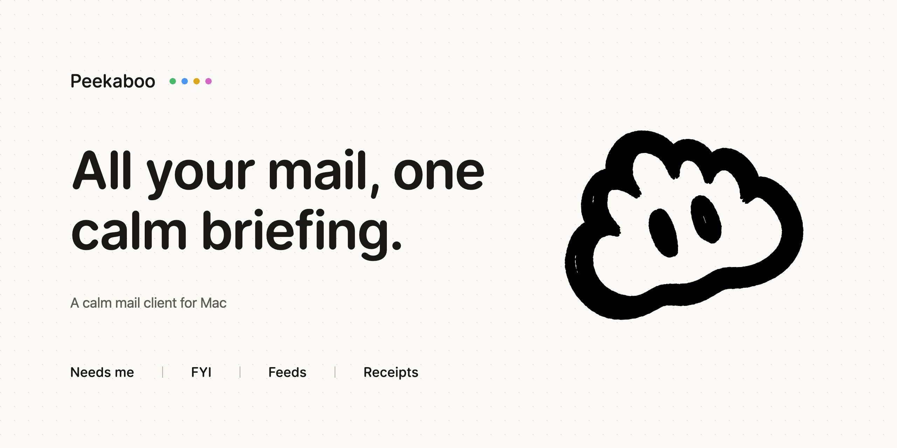

<picture>
  <source media="(prefers-color-scheme: dark)" srcset="assets/cover-dark.png">
  
</picture>

Peekaboo is a calm mail client for Mac. It joins your Gmail, Google Workspace and Microsoft 365 accounts into one quiet inbox. Its AI sorts your mail and tells you what needs you.

Mail lands in four lanes:

| Lane | What it holds |
| --- | --- |
| Needs me | Mail that waits for you. |
| FYI | Worth knowing, with nothing to do. |
| Feeds | Newsletters, promotions and digests. |
| Receipts | Purchases and invoices. |

In development. Mac first.
